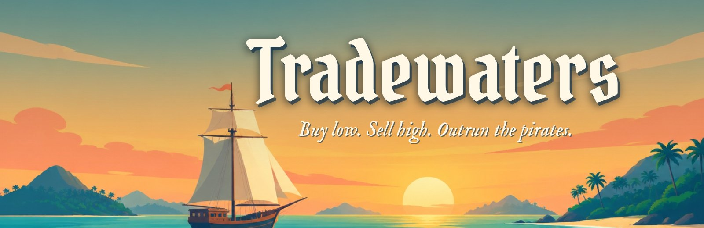
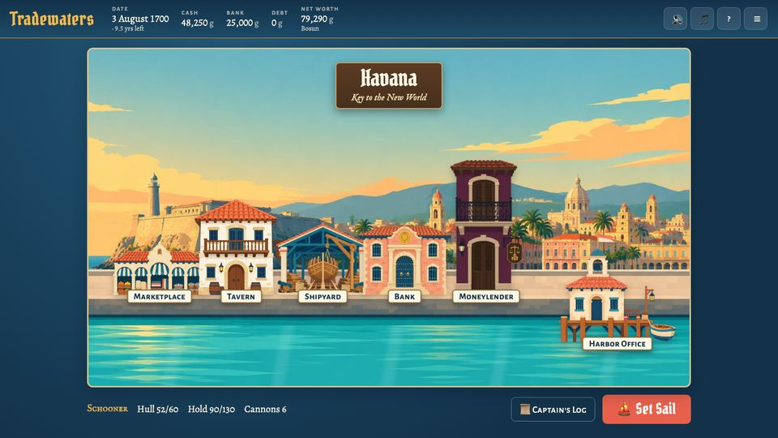
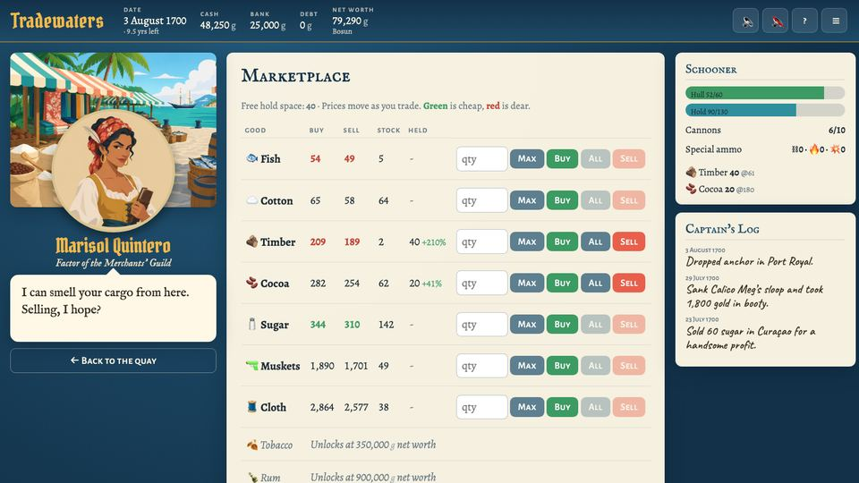
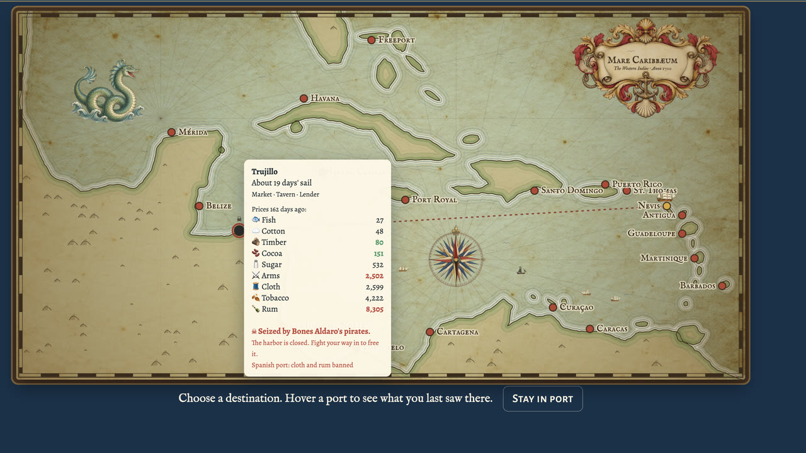
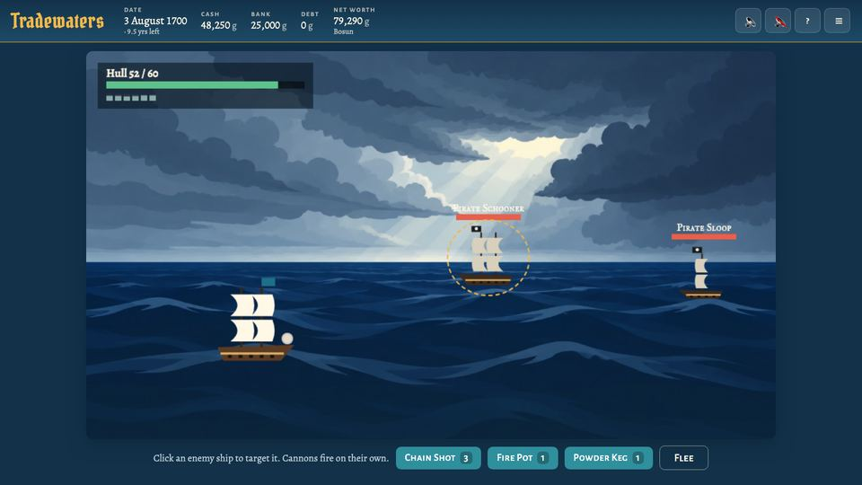
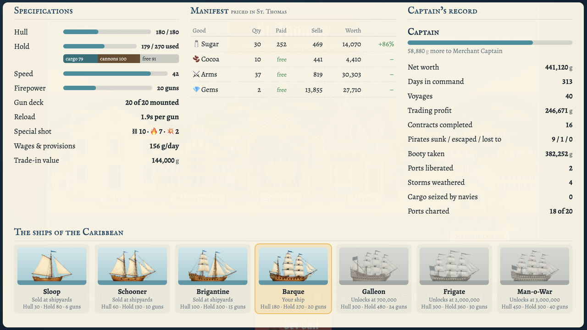
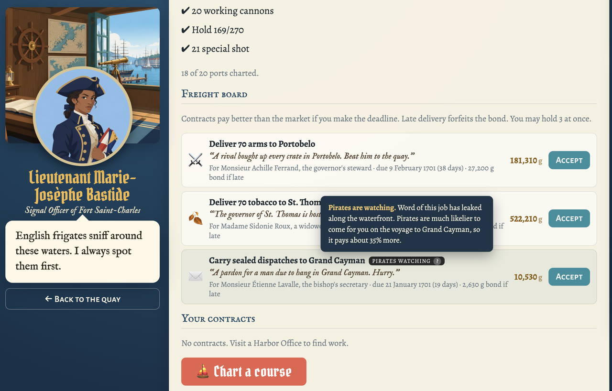
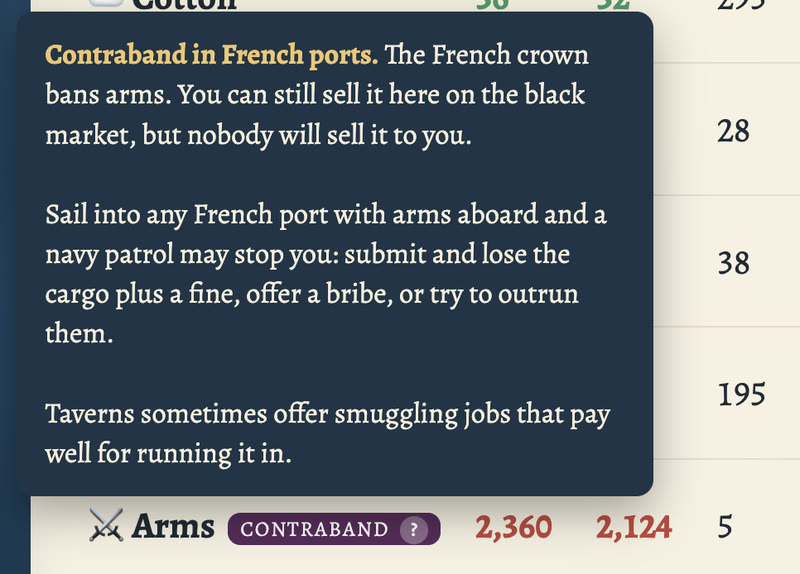

<p align="center">
  <a href="https://tradewaters.curry.io"></a>
</p>

<h3 align="center">
  ⛵ <a href="https://tradewaters.curry.io">Play now at tradewaters.curry.io</a> ⛵
</h3>

<p align="center">
  A Caribbean trading and piracy game that runs in your browser. No install, no sign-up, nothing to download.
</p>

<p align="center">
  <a href="https://tradewaters.curry.io"></a>
  
  
</p>

---

## A tribute to Tradewinds

**Tradewaters is a love letter to the *Tradewinds* series** of trading games by Sandlot Games.
Many of us lost whole evenings to them in the 2000s: sail a little sloop between Caribbean ports,
buy sugar where it's cheap, sell it where it's dear, and pray the pirates don't catch you on the
way. Sandlot unfortunately shut down and the original games are not available anymore, so this is a modern take that anyone can play in a
browser tab.

It keeps the core of the classics: **buy low, sell high, and survive the pirates.** Everything else
(code, art, characters, writing, music and balance) is new.

## Screenshots

<table>
  <tr>
    <td width="50%"><br><sub><b>Explore the port.</b> Each of the 20 ports has its own harbor and townsfolk. Click a building to step inside.</sub></td>
    <td width="50%"><br><sub><b>Trade.</b> Buy where prices are green, sell where they're red, and listen to the keepers.</sub></td>
  </tr>
  <tr>
    <td width="50%"><br><sub><b>Sail.</b> Chart a course between real Caribbean ports, check the prices you saw last time, and watch for ports seized by pirates.</sub></td>
    <td width="50%"><br><sub><b>Survive.</b> Real-time cannon battles, chain shot, fire pots and powder kegs, and a well-timed retreat.</sub></td>
  </tr>
  <tr>
    <td width="50%"><br><sub><b>Grow.</b> Upgrade from a sloop to a man-o-war, fit out your ship and unlock richer goods.</sub></td>
    <td width="50%" valign="middle">
      <b>How a voyage goes</b>
      <ol>
        <li>Buy cheap goods at the market</li>
        <li>Pick a port that pays well for them</li>
        <li>Weather storms and fight (or flee) pirates</li>
        <li>Sell high, upgrade your ship, repeat</li>
      </ol>
    </td>
  </tr>
  <tr>
    <td width="50%"><br><sub><b>Take contracts.</b> Freight jobs beat market prices if you make the deadline. Some come with pirates watching.</sub></td>
    <td width="50%"><br><sub><b>Run contraband.</b> Each nation bans some goods. Sell them on the black market, but mind the navy patrols.</sub></td>
  </tr>
</table>

## Features

- 🏝️ **20 real Caribbean ports,** each with a hand-painted city view and its own architecture, from Spanish Havana to Danish St. Thomas. Sailors, merchants, market women, soldiers, porters and stray dogs go about their business on every wharf.
- 🎭 **95 unique keepers,** one in every building of every port, each with their own portrait, personality and lines. Meet a Maya cotton trader in Mérida, a Danish innkeeper in St. Thomas and a retired pirate lending money in Port Royal. They react to your debts, your cargo and the state of your hull.
- 📈 **A living economy.** Every port makes some goods cheaply and pays dearly for others. Prices drift daily, shortages and gluts come and go, and your trading leaves a lasting mark, so the same route can't be milked forever.
- 🧾 **Contracts and contraband.** Harbor Offices post freight, courier and passenger contracts with deadlines and bonds; taverns offer smuggling runs and passengers who'd rather not be asked questions. Every job has its own client and reason, and some are urgent or have pirates watching, for bigger pay. Each nation bans certain goods, and its navy patrols the approaches, so you can submit, bribe or run.
- 🗺️ **A living sea chart.** An old parchment chart with water-lined coasts, rhumb lines, a swaying compass needle, a sea serpent and other ships working the lanes. Routes are found with A* pathfinding around coastlines traced from real geography.
- 🎬 **Smooth transitions.** Step through a building's door, unroll the chart, and dive down onto a port as you make landfall.
- 🔊 **Recorded sound.** Cannon fire, splintering hulls, a ship going down, creaking doors, anchor chains, harbor and open-sea ambience, generated with ElevenLabs.
- ⚔️ **Real-time naval combat** under a changing sky, from storm clouds to sunset, moonlight and morning mist. Load Chain Shot, Fire Pots and Powder Kegs into the next cannon to fire, each with its own sound, or flee if you're outgunned. Every pirate you sink has its own plunder, sometimes cargo too rich to buy yet that any market will take off your hands.
- ☠️ **Shipwrecks and bankruptcy.** Lose a battle and your ship goes down with her cargo, cannons and fittings. You're carried to the nearest home port to buy a new ship from your purse and bank, and if you can't afford one, you're bankrupt and the game is over.
- 🪆 **Curiosities and fittings.** Tavern traders sell charms after the magic dolls of Tradewinds 2 (some genuine, some with a catch, some fakes) and shipyards sell fittings: speed and heavy cannons, reinforced oak, bigger holds, evasive rigging and the Ultimate Compass.
- 🏰 **Hostile ports.** Now and then pirates seize a port and close its harbor. Storm its fortress and gun batteries to free it, for gold and gems.
- 🚢 **Seven ships,** from sloop to man-o-war. Every cannon costs cargo space, so choose between firepower and profit. Open the Ship & Captain sheet in any port to name your ship, compare its specs, price your cargo and review your record.
- 💰 **Bank, moneylender, sea charts and rumors.** The bank pays 1.5% a month and covers wages when your purse is empty; the moneylender charges 10% a month, wants it back within 90 days and sends collectors after overdue loans. Harder difficulties pay less and charge more.
- ⚓ **Running costs.** Crews draw daily wages and provisions, so slow routes and oversized gun decks cost real money.
- 🏆 **Career mode** (10 years to make your fortune) or **Endless,** on **Easy, Medium, Hard or Impossible.** Harder seas bring tougher, more frequent pirates and storms, thinner margins and dearer crews; change it any time from the menu. Progress autosaves in your browser.

## Play locally

It's plain HTML, CSS and JavaScript with no build step and no dependencies. Serve the folder and open it:

```bash
python3 -m http.server 8137
```

Then visit http://localhost:8137.

## Deploy

Hosted on Cloudflare (Workers static assets), which redeploys on every push to `main`:

- **Build command:** `sh scripts/build.sh`
- **Deploy command:** `npx wrangler deploy` (reads `wrangler.jsonc`, which publishes only `dist/`)

The build copies only `index.html`, `_headers`, `css/`, `js/` and `assets/` into `dist/`, so `docs/`
and other repo files never reach the public site. `_headers` sets the caching: `index.html` is
never cached and everything else is cached for a week. After changing CSS or JS, bump the `?v=`
number in `index.html` so returning players get the new files. Replaced images and sounds need
their revision bumped too: `SFX_REV` in `js/audio.js`, `PORTRAIT_REV` for portraits and the `?r=`
on the How to Play screenshots, both in `js/game.js`.

## Project layout

| Path | Purpose |
|---|---|
| `index.html`, `css/style.css` | Page shell and styling |
| `js/game.js` | Game state, screens (city view, buildings, map, combat), voyages, actions |
| `js/data.js` | Goods, ports, ships, enemies, ranks, difficulty levels, curiosities, fittings, coastline polygons |
| `js/economy.js` | Market simulation, trade pricing, tavern rumors |
| `js/cast.js` | The keepers of every building in every port, with their own lines |
| `js/characters.js` | Shared role dialogue (reactions, situation-aware remarks) and the line picker |
| `js/contracts.js` | Nations, contraband rules and contract generation |
| `js/city.js` | Per-port architecture style, sign text and wharf height for each city view |
| `js/map.js` | Coastline rasterization, A* routing, parchment chart rendering and its live decorations |
| `js/combat.js` | Real-time battle loop, sieges of pirate-held ports, special shot, sinking and ship drawing |
| `js/audio.js` | Recorded sound effects (with synthesized stand-ins), ambience loops and the music player |
| `js/titlefx.js` | Title-screen gulls and water glints |
| `js/folk.js` | Townsfolk walking the wharf in port city views |
| `assets/img/` | Title, interiors, battle and siege backdrops, ports, buildings, ships, forts, townsfolk, chart art, portraits and help screenshots |
| `assets/sfx/` | Sound effects and ambience loops (generated with ElevenLabs) |
| `assets/video/title.mp4` | Looping animated title backdrop |
| `assets/music/` | Soundtrack (M4A with MP3 fallbacks) and the prompts used to make it |
| `docs/readme/` | README banner and extra screenshots (not deployed) |

## Debugging

Open the browser console and run `TW._debug.nextEvents = ['pirates', 'storm', 'flotsam']` to force
events on the next voyage. `TW._debug.state` is the live game state. `TW._debug.winBattle()` jumps to the
post-battle plunder screen. `TW._debug.event('patrol', 'havana')` fires a sea event on the spot.
`TW._debug.hostile()` hands a charted port to pirates and `TW._debug.siege(id)` attacks it. During a
battle, `TW.Combat._advance(seconds)` runs it forward without waiting for frames.

## Credits

- **Inspiration:** the *Tradewinds* series by Sandlot Games.
- **Art:** generated with [Higgsfield](https://higgsfield.ai) and composed into the game by hand.
- **Music:** generated with [Suno](https://suno.com).
- **Sound effects:** generated with [ElevenLabs](https://elevenlabs.io).
- **Fonts:** [Pirata One](https://fonts.google.com/specimen/Pirata+One), [IM Fell English](https://fonts.google.com/specimen/IM+Fell+English), [Alegreya](https://fonts.google.com/specimen/Alegreya), [Alegreya Sans SC](https://fonts.google.com/specimen/Alegreya+Sans+SC) and [Caveat](https://fonts.google.com/specimen/Caveat), all from Google Fonts.
- **Built with** [Claude Code](https://claude.com/claude-code).

## Disclaimer

Tradewaters is an unofficial fan tribute. It is not affiliated with, endorsed by, or connected to
Sandlot Games or the owners of the *Tradewinds* trademarks. It contains none of the original games'
code, art, text, characters or audio; only the general idea of trading between ports carries over.
*Tradewinds* is a trademark of its respective owner.
